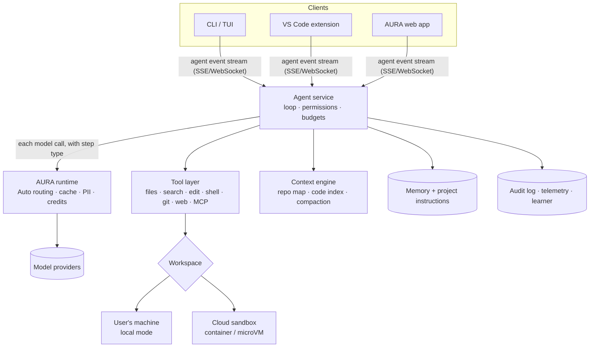

# AURA Agent Mode – what it takes to build a coding/work agent with AURA Auto

*Draft plan, 2026-10-01. Nothing in this document is built yet.*

## 1. The goal

Tools like **Claude Code** (Anthropic's agentic coding tool for the terminal, IDE and desktop) and **Google Antigravity** (an agent-first development environment) let a person give a goal ("fix the failing test", "add a settings page") and have an AI agent do the work. The agent:
- reads the codebase;
- plans;
- edits files;
- runs commands and tests;
- checks its own work;
- asks for permission when it should.

**AURA's angle:** the same experience, plus **AURA Auto for agents**. Instead of running every step of a long agent session on one expensive model, AURA decides per step:
- which model to use;
- how much context to send;
- when to split work into parallel sub-tasks;
- when to escalate.

The pitch is *the same results at a fraction of the cost per completed task, with a receipt for every decision.*

> **Why this fits AURA:** an agent session is hundreds of model calls. Most of them are mechanical: searching, reading, small edits, summarizing tool output. Only a few need deep reasoning: planning, hard bugs, final review. That is exactly the "cheap where possible, strong where needed" problem AURA already solves for single requests.

---

## 2. What AURA already has that an agent needs

| Agent need | Already in AURA |
|---|---|
| Choose a model per call within rules and budgets | Router + ExecutionPolicy (stricter-wins), learned routing (V4) |
| Plan → sub-tasks → combine | Intent compiler, planner, **sub-query decomposition**, graph executor (V3) |
| Run steps in parallel, survive crashes | Graph executor with checkpoints and resume |
| Check work, escalate on failure | Verify nodes, escalation ladder |
| Hard limits (loops, cost, time) | Loop protection, run budgets, wall-clock limits |
| Ask a human before risky actions | Human-approval nodes (V6) |
| Tools with safety boundaries | Calculator, SSRF-guarded fetch, read-only SQL, remote sandbox, web search |
| Keep context small | Context compiler, prompt caching awareness, response cache |
| Memory across sessions | Long-term memory + knowledge bases, personal memory |
| Don't leak secrets / personal data | PII redact/block policy, envelope encryption |
| Pay for it | Credits, BYOK, plans and entitlements |
| Prove the savings | Telemetry, "How AURA optimized this", Shadow and evaluation |

---

## 3. What's missing (the build list)

### 3.1 Model tool use in the gateway *(foundation, required first)*
Today the gateway **rejects** `tools` / `tool_choice` in requests, and the provider adapters don't implement tool calls. An agent is a loop of "model asks to call a tool → we run it → we send the result back", so this comes first:
- A provider-neutral tool-call format in `aura_providers`, mapped to Anthropic's tool-use content blocks and OpenAI-style function calls.
- Streaming of tool-call arguments, plus strict validation of the arguments against each tool's schema before running anything.
- Router awareness: only models with the tool-use capability are eligible for agent steps.
- **Telemetry per tool call:** name, duration, success, and bytes of output (content stays private).

### 3.2 The agent loop
- **A model-driven loop:** observe → think → call tools → observe… until done or a limit is hit. This differs from today's fixed template graphs: the model decides the next step.
- **Turn state:** messages, tool results, open sub-tasks, files touched, and cost so far.
- **Stopping rules:** task done (the model says so *and* checks pass), budget or turn limit, a repeated-failure detector (same error N times → escalate or ask), or user interrupt.
- **Plan mode:** produce and show a plan first; execute only after approval.

### 3.3 Coding tools
| Tool | Notes |
|---|---|
| List / glob files, read file (with line ranges) | Respect `.gitignore`, file size caps |
| Search code (regex/grep) | Fast; results truncated with counts |
| Edit file (exact replace / patch) | Diff-based edits, not whole-file rewrites (cheaper, safer, reviewable) |
| Write new file | |
| Run shell command / tests | Sandboxed, with timeouts and output caps |
| Git: status, diff, commit, branch | Commits only with permission |
| Web fetch / search | Reuse AURA's SSRF-guarded fetch and search |
| Browser (optional, later) | For checking web UIs, like Antigravity's browser agent |
| **MCP client** | Connect to external tools (GitHub, Jira, databases) through the Model Context Protocol instead of writing every integration |

### 3.4 Where the code runs (workspaces and sandboxes)
Two modes, same agent:
- **Local mode (CLI/IDE):**
  - the agent runs on the user's machine against their checkout;
  - only model calls go through AURA;
  - this is the simplest to ship and keeps the code on-device.
- **Cloud mode:**
  - each session gets an isolated container or microVM (gVisor or Firecracker) with the repo cloned;
  - network egress follows an allow-list;
  - secrets are injected at egress, never visible to the model;
  - the session expires automatically.
- Either way: never run commands from repository content or web pages as instructions. Treat them as data (**prompt-injection defense**).

### 3.5 Permissions and safety
- **Permission modes:**
  - *ask every time*;
  - *auto-accept file edits* (still ask for shell and network);
  - *plan only*;
  - *autonomous inside an allow-list*.
- **Destructive-action guard:** `rm -rf`, force-push, dropping tables, editing CI secrets, sending messages. Always ask, whatever the mode.
- **Human approval** reuses AURA's approval nodes. The exact command or diff is shown, and the exact thing approved is what runs.
- **Audit log** of every tool call and approval (AURA's append-only audit log).
- **Secret scanning** on diffs before commit. The PII/secret detector already exists.

### 3.6 Context engineering (where most of the cost goes)
- **Repo map:** file tree plus symbols (functions, classes) per file, built with tree-sitter and refreshed incrementally. The agent reads the map first, then only the files it needs.
- **Semantic code index:** embeddings over code chunks so "where is auth handled?" finds the right files. Reuse AURA's hybrid retrieval.
- **Tool-output trimming:** long test logs and command output are summarized by a small model, or cut to the relevant lines, before they enter context.
- **Session compaction:** when the conversation gets long, older turns are summarized and the original goal, decisions and open tasks are kept.
- **Prompt caching:** keep the stable prefix (system prompt, repo map, tool definitions) identical across turns so providers can cache it. This is a large saving on long sessions.
- **Project instructions file:** a checked-in file with build commands, conventions and "don'ts" (like Claude Code's `CLAUDE.md`), always loaded.

### 3.7 AURA Auto for agents (the differentiator)
Per-step routing policy, all inside the user's limits:

| Step type | Default tier | Escalate when |
|---|---|---|
| Understand the task, make the plan | Strong (frontier) | n/a |
| Search, list, read, summarize tool output | Small | Never needs escalation |
| Small, well-specified edits | Small/medium | Tests or type-check fail twice → medium → strong |
| Hard bug, design decision, unclear failure | Strong | n/a |
| Final self-review of the diff | Medium (strong for high-risk changes) | Review finds issues |

How it works:
- **Signals the router uses:**
  - step type;
  - files touched;
  - change size;
  - failure count;
  - the risk level of the task;
  - the user's mode: Auto / Fast / Balanced / Best, same as the chat.
- **Sub-agents via decomposition:** independent sub-tasks (e.g. "update the API", "update the UI", "write tests") run in parallel, each with its own small context and its own model choice. This is the sub-query engine applied to work instead of questions.
- **Learning:** reward = task success (tests pass, user accepts the diff) − cost. The V4 bandit and off-policy evaluation tune the step→model mapping per user or organization over time.
- **Receipts:** the "How AURA optimized this" panel becomes a per-task report: steps, models used, cost vs all-frontier, and time.

### 3.8 Verification
- After edits, run the project's checks automatically: tests, type-check, lint, build.
- A failing check feeds back into the loop with only the relevant lines.
- **Definition of done:** checks pass, the diff is reviewed, and the summary is written. It is not done just because the model says it is.
- Optional: AURA Shadow for agents, which replays past tasks with a cheaper routing policy to prove it before switching.

### 3.9 Clients (where people use it)
1. **CLI / terminal UI.** Fastest to ship and what developers expect. It streams the agent's steps, diffs and permission prompts.
2. **VS Code extension, then JetBrains.** Inline diffs, accept/reject per hunk, chat panel.
3. **Web app.** Cloud-mode sessions started from the AURA app (and from GitHub issues later).
4. *(Long-term)* an agent-first editor in the style of Antigravity. This is a large investment, so only do it once the core agent is proven.

All clients speak one streaming event protocol:
- events for plan, step, tool call, approval request, diff, check result, cost update and done;
- the same design as today's chat SSE events.

### 3.10 Evaluation (prove it works and is cheaper)
- **Public benchmarks:** SWE-bench Verified style (real GitHub issues) and terminal-task suites.
- **An internal suite of tasks on our own repos.**
- **The headline metric is cost per solved task** at equal success rate, Auto vs all-frontier. This is AURA's marketing number.
- **Regression gate:** a routing or prompt change can't ship if the success rate drops beyond tolerance. Same evidence gate as V2.

### 3.11 Billing and limits
- A per-task budget the user can set ("stop at $2").
- Credits for the consumer tier; BYOK for power users.
- Team/enterprise seats.
- Live cost meter during a session.

---

## 4. Architecture sketch

The **agent service** is a new app (`apps/agent`). It calls the existing **runtime** for every model call, passing the step type so Auto routing can choose well. Tools and workspaces are new packages.

---

## 5. Phased roadmap

| Phase | Scope | Outcome |
|---|---|---|
| **A0 – Foundation** | Tool use in the gateway and providers (§3.1); step-type hints in routing | Any client can run an agent through AURA with Auto routing |
| **A1 – Local CLI agent** | Agent loop, coding tools, permission modes, project instructions, verification, cost meter | A usable "Claude Code-style" CLI that works on your repo through AURA |
| **A2 – Context and cost** | Repo map, code index, tool-output trimming, compaction, prompt-cache-friendly layout; per-step routing table + escalation | Measurably lower cost per task; first benchmark numbers |
| **A3 – Parallel sub-agents and learning** | Task decomposition into sub-agents; reward from tests/acceptance; bandit tuning; Shadow for agents | "Same success, X% cheaper" with evidence |
| **A4 – Cloud sandboxes and IDE** | Container/microVM workspaces, GitHub integration, VS Code extension, MCP client | Team product; runs without the user's machine |
| **A5 – Agent-first editor (optional)** | Antigravity-style environment with browser agent | Only if A1–A4 show strong pull |

---

## 6. Risks and how to handle them

| Risk | Mitigation |
|---|---|
| Cheaper models make more mistakes in agent loops, wasting the savings | Escalate on repeated failure; measure cost **per solved task**, not per call; evidence gate before changing routing |
| Prompt injection from repository files or web pages | Treat tool output as data; destructive-action guard; approvals; sandboxing; allow-listed egress |
| Destructive actions on a user's machine | Permission modes, always-ask list, checkpoints/undo for file edits, no auto-commit by default |
| Context bloat makes long sessions expensive | Repo map first, trimming, compaction, prompt caching |
| Competing with well-funded tools | Lead with cost-per-task receipts and model choice (any provider, BYOK); start CLI-first and stay focused |
| Provider differences in tool-calling behaviour | Provider-neutral tool format with per-provider adapters and conformance tests |

---

## 7. First concrete steps (when this is picked up)
1. Add tool-call support to `aura_providers` (Anthropic + OpenAI-compatible) and allow `tools` through `/v1/chat/completions`, with conformance tests.
2. Define the agent event protocol, reusing the chat SSE event style.
3. Build the minimal loop with five tools: read, search, edit, run command, finish. Ship it as a CLI with "ask every time" permissions.
4. Add step-type hints to routing, and a first routing table (§3.7).
5. Create a 20-task internal benchmark and record cost per solved task, Auto vs all-frontier.
