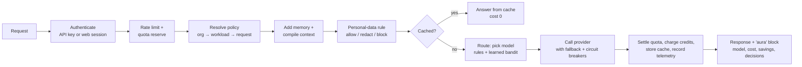

# AURA: what it is, what problem it solves, and how it works

This guide explains everything built so far, in plain language first and then in technical detail. It is written for founders, engineers joining the project, and anyone evaluating it.

- **Status at the time of writing (2026-10-01):** versions V1 to V5 are complete, plus a ChatGPT-style chat with Auto-mode sub-queries; V6 (Enterprise) is in progress. 288 automated tests pass. The done/left checklist is [STATUS.md](STATUS.md).
- **Where to look for more:** the decisions behind each part are recorded in [`docs/adr/`](adr/), and the repository overview is in [`README.md`](../README.md).

---

## 1. The problem

Companies and individuals now send millions of requests to AI models (Claude, GPT, Gemini and others). Almost all of them do it the same way: **pick one big model and send everything to it.** That is wasteful in several ways.

| Waste | What actually happens | Why it matters |
|---|---|---|
| **Oversized models** | A frontier model answers "what's 6×7?" or classifies a support ticket. | Frontier models cost 10–50× more than small ones, which handle most tasks just as well. |
| **Bloated context** | Whole documents, long chat histories and duplicated text are pasted into every request. | You pay per token, and bigger inputs are also slower and can lower quality. |
| **Repeated work** | The same or nearly the same question is asked again and again. | Each repeat is paid in full, even when the answer would be identical. |
| **No measurement** | Nobody knows which workloads cost the most, or whether a cheaper setup would be just as good. | Teams are afraid to change anything, so the waste stays. |
| **No safe way to change** | Switching models or prompts in production is a gamble. | A quality drop reaches customers before anyone notices. |
| **Multi-step tasks done badly** | Research, coding or analysis is crammed into one giant prompt. | Results are worse, and every step runs at frontier prices. |

For **businesses** this means AI bills that grow faster than revenue, with no safe lever to pull. For **individuals** it means paying for expensive subscriptions, or getting worse answers on free tiers, without knowing which model fits which task.

## 2. The idea

> **You provide the goal. AURA decides how it should be computed.**

AURA sits between your application (or you, in the personal app) and the AI providers. For every request it decides:

- **which model** to use (cheap, medium or frontier);
- **how much context** to send (trim, deduplicate, compress, retrieve only what's relevant);
- **whether it already has the answer** (cache);
- **whether the task needs several steps** (plan, use tools, verify);
- **what is allowed** (budget, data region, personal-data rules, approved models).

Then it **proves** the savings: it measures quality, cost and latency, compares a cheaper setup against the current one on real traffic before switching, and rolls back automatically if anything gets worse.

All of these decisions together form one object, the **ExecutionPolicy**. AURA's job is to find the cheapest policy that still meets your quality, latency and compliance requirements:

```
minimise   Cost(policy)
such that  Quality(policy) ≥ target,  Latency(policy) ≤ limit,  policy is allowed
```

### One engine, two products

| | **AURA for Business (B2B)** | **AURA Personal (B2C)** |
|---|---|---|
| Who | Startups and enterprises with AI in production | Individuals |
| How they use it | Point their existing OpenAI-compatible code at AURA (a change of one URL) | A chat app at `/app` |
| What they get | Lower AI bills with proof of no quality loss: X-Ray → Shadow → Pilot → Autopilot | Better answers for less money, with a transparent "How AURA optimized this" panel |
| How they pay | Subscription plans (Startup, Growth, Enterprise) | Free / Plus / Pro plans plus credit packs |

Both products run on **the same engine**. A third app, the **Superadmin console**, is for the AURA team to run the business.

---

## 3. How it works: a request's journey

When an application calls AURA (for example `POST /v1/chat/completions` with `model: "aura/auto"`), the request passes through these stages:



1. **Authenticate.** Machines use API keys (`aura_sk_...`). The web app uses a secure session cookie.
2. **Rate limit and quota.** Usage is reserved atomically in Redis before any money is spent, so limits can't be exceeded even under heavy parallel traffic.
3. **Resolve the policy.** Rules from the organization, the workload and the request are merged with **stricter-wins** semantics. A request can never loosen an organization's rules (for example "never use frontier models" or "data must stay in India").
4. **Add memory and compile context.** Relevant long-term memory and knowledge-base passages are retrieved. Then the context is trimmed, deduplicated and compressed to fit a budget.
5. **Personal-data rule.** If the policy says *redact*, emails, phone numbers, card numbers, Aadhaar, PAN and API secrets are replaced with placeholders **before any provider sees them**. If it says *block*, the request is refused.
6. **Cache.** An exact match, or a semantically similar previous answer, is returned for free.
7. **Route.** The router picks the cheapest model that fits the task's complexity and the policy. A learning layer (V4) improves the choice over time from real outcomes.
8. **Call the provider.** If a model fails, AURA falls back to the next one. Unhealthy models are skipped automatically by circuit breakers shared across all servers.
9. **Settle.** Quota is committed, consumer credits are charged, the answer is cached, and telemetry is emitted.
10. **Respond.** The answer comes back in the standard OpenAI format, plus an **`aura` block**: which model answered, why, what it cost, what a frontier model would have cost, and every optimization applied.

---

## 4. What has been built, version by version

### V1 – Runtime and X-Ray *(complete)*
The foundation: a gateway that works, and a report that sells it.

- **Identity and accounts.**
  - Sign-in with passwordless email links or Google.
  - Personal accounts, organizations, projects and environments (development / staging / production).
  - Roles: owner, admin, engineer, analyst, billing, viewer.
  - API keys: shown once, stored only as a peppered hash, revocable instantly.
- **Billing foundation.**
  - A versioned plan catalog. Existing subscribers keep their plan version when prices change.
  - Entitlements: every feature is gated by a plan check, never by `if plan == "pro"`.
  - Razorpay subscriptions and webhooks, a double-entry credit ledger, and usage counters reconciled from Redis to Postgres.
- **Model providers.** Anthropic (official SDK), any OpenAI-compatible API (OpenAI, OpenRouter, local models) and a stub for testing. Prices are versioned in a model catalog.
- **Runtime gateway.**
  - Endpoints: an OpenAI-compatible `/v1/chat/completions` (normal and streaming), plus native `/v1/execute` and `/v1/models`.
  - Fallback chains, circuit breakers, timeouts and budgets on every call.
- **BYOK (bring your own key).** Customers can store their own provider keys. These are envelope-encrypted (AES-256-GCM, bound to the owning account) and decrypted only inside the runtime.
- **Telemetry.** Every execution produces a versioned event, which goes to NATS JetStream and then to ClickHouse for analytics, deduplicated by event ID.
- **X-Ray.**
  - **Input:** a customer uploads logs (JSONL/CSV) or routes traffic through AURA.
  - **Analysis:** X-Ray groups the traffic into workloads and runs seven waste detectors: *model downgrade, exact cache, semantic cache, prompt caching, context trimming, truncation waste, failed calls*.
  - **Output:** an estimate of monthly savings with confidence levels, as an HTML report.
  - **Public funnel:** there is also a public "Get your AI Workload Report" page that captures leads.
- **Shadow runs.** AURA replays a sample of real traffic against cheaper candidate setups, then judges quality:
  - rule checks;
  - an LLM judge that compares answers with positions swapped to avoid bias;
  - statistics with confidence intervals (Wilson, bootstrap).

  The output is a "current vs AURA" comparison of cost, quality and latency.
- **Superadmin console.** Requires TOTP two-factor login. It shows:
  - platform metrics and revenue (MRR, ARR);
  - account management (suspend, restore, change plan, grant credits, overrides);
  - leads and a full audit log.

### V2 – Optimizers and safe deployment *(complete)*
Turning "this would save money" into "this is now saving money, safely".

- **Context compiler.** Ranks passages by relevance (BM25 plus reciprocal rank fusion), removes duplicates, compresses, and orders content for how models read. Modes: strict, auto, budget.
- **Response cache.**
  - **Exact cache:** returns the stored answer when the same request repeats.
  - **Semantic cache:** returns a stored answer for a similar request. It uses Redis vector sets with risk-aware similarity thresholds, and is always scoped to one tenant.
- **Long-term memory and knowledge bases (RAG).** Hybrid retrieval: Postgres full-text search plus vector search, fused and scored by relevance × recency × importance. Also:
  - **RAG tuning:** finds the best retrieval settings using labelled questions;
  - **"forget" requests:** real deletions, not soft deletes.
- **Prompt registry and optimizer.** Versioned prompts. The optimizer generates candidate rewrites, evaluates them, and deploys or rolls back.
- **Policy engine.** Policy versions are immutable. Deployments follow a lifecycle: draft → shadowed → canary → active → rolled back.
- **Evidence gate.** A policy can't be deployed unless it has enough evaluated samples and the quality drop's lower confidence bound is within tolerance.
- **Canary releases.** Sticky traffic splits at 1 / 5 / 10 / 25 / 50 / 100 %. An online monitor watches error rate, cost, latency and quality signals, and rolls back automatically.
- **Experiments and business outcomes.** `POST /v1/outcomes` lets customers report real results ("the ticket was resolved"), giving a cost-per-outcome metric.
- **Recommendation engine.** Turns X-Ray findings and Shadow results into ranked, ready-to-apply policy changes.

### V3 – Execution graphs *(complete)*
For tasks that need more than one model call.

- **Intent compiler.** Classifies a goal as chat, QA, research, summarize, code or math, and assesses its risk.
- **Planner.** Builds a graph of steps from templates. For example, research becomes *search → analyze → verify → synthesize*. Math needs no LLM at all: the calculator answers it for $0.
- **Event-driven executor.**
  - Runs independent steps in parallel.
  - Saves checkpoints so a crashed run resumes where it left off.
  - Verifies answers; the depth of verification depends on risk.
  - Escalates to a stronger model when a check fails.
  - Enforces hard limits on depth, nodes, retries, budget and wall-clock time.
- **Safe tools.**
  - A calculator that parses expressions safely, with no `eval`.
  - Web fetch protected against SSRF (it can't reach internal networks).
  - Read-only SQL.
  - A remote code sandbox.
  - Web search.
- **Async runs.** `POST /v1/runs` queues long jobs, and `GET /v1/runs/{id}` returns results. Inputs and outputs are stored encrypted.

### V4 – Learned execution policies *(complete)*
AURA gets better with use.

- **Learned routing (LinUCB contextual bandit).** Improves model choice from real outcomes, but only reorders what the rules already allow. **Rules always win.** Exploration is capped per tenant.
- **Off-policy evaluation.** Every logged decision records its true selection probability, so AURA can estimate how a new policy *would have* performed before trying it live. It uses IPS, SNIPS and doubly-robust estimators. Endpoint: `POST /v1/learning/evaluate`.
- **Global learning with consent.** Accounts that opt in contribute anonymous, aggregated numbers (never content). These warm-start new tenants.
- **Autopilot.** For opted-in accounts, a proven Shadow result automatically becomes a canary deployment, which is then promoted or rolled back on its own.
- **Optimization health.** A superadmin view of deployments, rollbacks and autopilot activity.

### V5 – AURA Personal (B2C) *(complete)*
The consumer product, at `/app` on the web app.

- **ChatGPT-style chat.** Multiple saved conversations (encrypted at rest) in a sidebar, streamed answers with Stop, and dark mode. Modes are *Auto* (AURA decides, and splits multi-part questions into sub-questions answered in parallel by the cheapest capable models), *Fast*, *Balanced* or *Best*.
- **"How AURA optimized this" panel.** Shows the model used, why it was picked, the cost compared with a frontier model ("saved 98%"), what paid for it, tokens, latency, fallbacks and the optimizations applied.
- **Shareable cards.** A public "Optimized by AURA" card. It contains numbers only: never your prompt, answer, memory or keys.
- **Credits.**
  - 1 credit ≈ $0.0001 of AI usage.
  - Each plan grants monthly credits. Unused *granted* credits expire; purchased and referral credits never do.
  - Credit packs are bought through Razorpay, and credits are added only after the signed payment webhook confirms the exact amount.
  - When credits run out, your own provider keys (BYOK) keep working.
- **Personal memory.** Preferences such as "reply in Hindi" or "keep it short" are applied automatically. You can view and delete them, or wipe everything.
- **Referrals.** Both people get 2,000 credits. Self-referrals are blocked, each person can redeem one code, and rewards are capped monthly.
- **Subscription and "Bring AURA to your team".** Upgrade to Plus or Pro, or create an organization while keeping your personal account.
- **Unit economics.** Consumer margin is revenue minus AI cost minus infrastructure. It appears in the admin console, and an alert fires when it goes negative.

### V6 – Enterprise *(in progress)*

| Feature | Status |
|---|---|
| **Personal-data (PII) policy**: allow / redact / block emails, phones, cards (Luhn-checked), Aadhaar (Verhoeff-checked), PAN and API secrets before any provider sees them | ✅ Done and tested |
| **Human approval steps**: a graph run pauses until a person approves. Only signed-in people can approve (API keys can't), the exact reviewed content is released, and a rejection ends the run | ✅ Done and tested |
| **Team members and custom roles**: add, change and remove members. Custom roles are possible on plans with advanced RBAC. Nobody can grant permissions they don't hold, only owners create owners, and an organization always keeps one owner | ✅ Done and tested (API). The screens are not built yet |
| **SSO (OIDC and SAML), domain verification, SCIM provisioning** | 🟡 Database tables and the OIDC, SAML and DNS adapters are written. The login flow, SCIM endpoints and tests are not done yet |
| Customer-managed encryption keys, audit export and SIEM streaming, data retention, region pinning, status page and SLA, verified-savings pricing, Helm and Terraform | ⬜ Not started |

---

## 5. The pieces (for engineers)

### Apps

| App | Port | Purpose |
|---|---|---|
| `apps/api` | 8000 | **Control plane**: accounts, billing, X-Ray, Shadow, policies, prompts, members, admin. Strongly consistent; Postgres is the source of truth. |
| `apps/runtime` | 8100 | **Data plane**: chat, execute, runs, memory, outcomes. High-volume and stateless; reads hot state from Redis. |
| `apps/workers` | – | Background jobs: telemetry → ClickHouse, Shadow and graph jobs, outbox relay, canary monitor, autopilot, credit grants and margin alerts. |
| `apps/web` | 3000 | Next.js site: marketing, X-Ray funnel, team dashboard, personal app. |
| `apps/admin` | 3001 | Next.js superadmin console. |

### Packages (Python, one job each)

| Package | Responsibility |
|---|---|
| `shared` | Settings, error types, IDs, Redis key builder and Lua scripts, event contracts, encryption |
| `db` | Database models, migrations (0001–0016), row-level security, audit log, outbox, job queue |
| `cache` | Two-tier cache (in-process + Redis) with stampede protection |
| `auth` | Sign-in, sessions, API keys, roles, members, SSO adapters |
| `billing` | Plans, entitlements, subscriptions, credits, referrals, unit economics |
| `credentials` | BYOK provider keys (encrypted) |
| `providers` | Model adapters, model catalog, pricing, embeddings |
| `policy` | ExecutionPolicy, stricter-wins merging, PII detection |
| `routing` | Model router |
| `context` / `memory` | Context compiler; session, working and long-term memory, RAG tuning |
| `engine` | The execution pipeline, response cache, learned selector, share cards |
| `graph` | Execution graphs: intent, planner, executor, tools, approvals |
| `xray` / `shadow` / `evaluation` | Waste discovery, replays, statistics and judging |
| `deploy` / `prompts` / `learning` | Policy deployment and canaries; prompt registry; bandits and off-policy evaluation |

Module boundaries are **enforced automatically** (`import-linter`). Lower layers can't import higher ones, and pure domain code can't do I/O.

### Infrastructure choices and why

| Choice | Why |
|---|---|
| **PostgreSQL with row-level security** | Every tenant table is protected twice: by the application *and* by the database itself. A bug can't leak one customer's data to another. |
| **Redis, split by role** (state / cache / vector) | Quotas, sessions and rate limits must never be evicted. Cache entries can be. Vectors power semantic cache and memory. |
| **Lua scripts in Redis** | Rate limits and quota reservations are atomic, so no over-spending under concurrency. |
| **Transactional outbox** | Configuration changes reach every server's cache within about a second, without losing messages. |
| **NATS JetStream → ClickHouse** | High-volume telemetry is decoupled from requests and stored for fast analytics. |
| **Envelope encryption** | Every secret has its own key, wrapped by a master key (a cloud KMS in production), and is bound to its owner. |
| **Fail-open vs fail-closed** | If Redis is down, business customers keep running (an outage of ours mustn't stop their product), while free consumers are paused (an outage mustn't become free unlimited usage). |

---

## 6. Security and privacy, in one place

- Passwords are never stored. Sign-in uses one-time links or Google, and sessions are secure HttpOnly cookies with CSRF protection.
- API keys are hashed with a secret pepper and revocable instantly. Machine keys can never manage billing, members or keys.
- Each tenant's data is isolated by both the application and the database (RLS). Cross-tenant requests return "not found", so they don't even confirm the data exists.
- Provider keys and stored inputs are encrypted with AES-256-GCM and bound to their owner.
- The PII policy redacts or blocks personal data before it leaves AURA.
- Share cards hold numbers only.
- Every admin and billing action is recorded in an append-only audit log.
- Payments are trusted only after a signed webhook confirms the amount.

---

## 7. Running it locally

Everything currently runs on this machine:

| URL | What |
|---|---|
| http://localhost:3000 | Website and personal app (`/app`), team dashboard (`/dashboard`) |
| http://localhost:3001 | Superadmin console |
| http://localhost:8000/docs | Interactive API documentation |
| http://localhost:8100 | Runtime (AI gateway) |

- **Datastores:** a private Postgres and Redis live under `.local/`, on ports 55432 and 56379.
- **Models:** the stub provider is on, so no AI costs are incurred. To use real Claude, set `AURA_ANTHROPIC_API_KEY` in `.env`.

### Demo logins
Sign-in is passwordless. Run `uv run aura-api seed-demo` once to create the accounts. Then get a one-time link for any of them (valid 15 minutes):

```bash
uv run aura-api login-link --email plus@demo.aura
```

| Email | Account |
|---|---|
| `free@demo.aura`, `plus@demo.aura`, `pro@demo.aura` | Personal accounts on each plan |
| `owner@acme.demo` | Owner of the "Acme (demo)" team, Growth plan |
| `admin@acme.demo`, `dev@acme.demo`, `viewer@acme.demo` | Admin, engineer and viewer in Acme |
| `admin@aura.demo` | Superadmin (use `--app admin`; set up TOTP on first sign-in) |

The Acme API key and these details are in `.local/demo-accounts.md`, which is not committed.

### Tests and checks
```bash
uv run pytest                                           # 288 tests, real Postgres + Redis
uv run ruff check . && uv run mypy && uv run lint-imports
pnpm --filter @aura/web exec tsc --noEmit               # frontend type-check (Node 22)
```

---

## 8. Known gaps and honest caveats

- **V6 is unfinished.** The remaining work is SSO and SCIM, customer-managed keys, audit export and SIEM, retention, region pinning, status and SLA, verified-savings pricing, Helm and Terraform, plus the enterprise screens (members, roles, SSO, approvals).
- **Not exercised locally:** the NATS and ClickHouse adapters have no local servers, so telemetry analytics are untested here. Razorpay needs test keys to try real payments.
- **Frontend coverage:** the personal app was verified in a real browser (sign-in, chat, panel, share card, usage, subscription, invite, memory). The team dashboard pages and the admin console as a superadmin have not been clicked through yet.
- **Prices are hypotheses.** Plan and credit-pack prices in `catalog.yaml` still need validating with real users.
- **Deferred items**, recorded in the ADRs:
  - product analytics (PostHog);
  - a PWA build;
  - Documents and Research tabs in the personal app;
  - end-to-end browser test suites (Playwright);
  - graph-template search in the learner.
